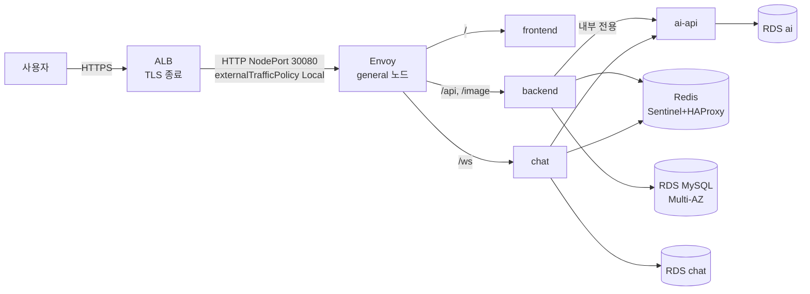
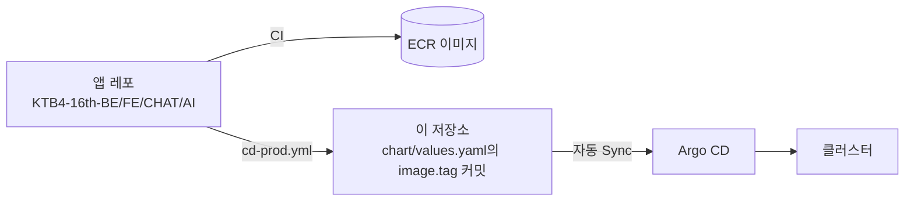

<div align="center">

# mulo-kube

**MULO 서비스를 AWS 서울 리전 kubeadm 클러스터에 배포하는 GitOps 저장소**

_Git이 설정의 원본이고, Argo CD가 배포합니다._

[](https://kubernetes.io)
[](https://argo-cd.readthedocs.io)
[](https://helm.sh)
[](https://gateway.envoyproxy.io)
[](https://aws.amazon.com)

</div>

---

## 목차

- [개요](#개요)
- [주요 기능](#주요-기능)
- [기술 스택](#기술-스택)
- [아키텍처](#아키텍처)
- [디렉터리](#디렉터리)
- [배포 흐름](#배포-흐름)
- [AWS 의존성](#aws-의존성)
- [시작하기](#시작하기)
- [운영](#운영)
- [AZ 장애 대응](#az-장애-대응)
- [차트 작성 규칙](#차트-작성-규칙)
- [알려진 제약](#알려진-제약)

## 개요

MULO의 frontend, backend, chat, ai-api와 이를 받치는 플랫폼 구성요소(게이트웨이, 시크릿, 모니터링, 자동 확장)를 Helm 차트와 values로 관리합니다.

- **클러스터**: AWS EC2 위의 kubeadm, 컨트롤 플레인 3대(AZ마다 1대) + 워커 4개 역할
- **배포**: `main` 브랜치에 커밋하면 Argo CD가 자동으로 맞춥니다(Vault만 수동 Sync).
- **인프라**: VPC, EC2, ALB, RDS 같은 AWS 리소스는 별도 Terraform 저장소에서 관리합니다. 이 저장소는 클러스터 안만 다룹니다.

## 주요 기능

- [x] app-of-apps 하나로 플랫폼과 앱 전체를 Argo CD가 관리
- [x] 앱 레포의 CD가 이미지 태그만 커밋하면 자동 배포
- [x] 3개 AZ 분산: 앱 Pod는 AZ마다 같은 수, 장애 뒤에는 descheduler가 다시 나눔
- [x] 두 단계 자동 확장: HPA/KEDA(CPU, backend는 RPS) → Cluster Autoscaler(노드)
- [x] 비밀 값은 Git 밖: Vault(KMS auto-unseal) → External Secrets → Kubernetes Secret
- [x] Envoy Gateway(Gateway API)로 도메인·경로 라우팅, 실패 Pod 자동 제외와 재시도
- [x] Redis Sentinel + HAProxy로 master 자동 전환
- [x] Prometheus·Grafana·Loki·Alloy로 지표와 로그 수집
- [x] AWS FIS로 AZ 장애 훈련을 반복해 검증

## 기술 스택

| 구성요소 | 역할 |
|---|---|
| [Argo CD](https://argo-cd.readthedocs.io) | GitOps 배포 (app-of-apps) |
| [Envoy Gateway](https://gateway.envoyproxy.io) | Gateway API 구현, 외부 트래픽 입구 |
| [Calico](https://www.tigera.io/project-calico/) | CNI (VXLAN). 설치와 NetworkPolicy는 저장소 밖 |
| [Vault](https://www.vaultproject.io) + [External Secrets](https://external-secrets.io) | 비밀 값 저장과 Secret 동기화 |
| [KEDA](https://keda.sh) + HPA | Pod 자동 확장 (CPU, Prometheus RPS) |
| [Cluster Autoscaler](https://github.com/kubernetes/autoscaler) | 노드(ASG) 자동 확장 |
| [descheduler](https://github.com/kubernetes-sigs/descheduler) | AZ 분산 규칙을 어긴 Pod 재배치 |
| [VPA](https://github.com/kubernetes/autoscaler/tree/master/vertical-pod-autoscaler) | 리소스 requests 추천 |
| [AWS EBS CSI](https://github.com/kubernetes-sigs/aws-ebs-csi-driver) | gp3 영구 볼륨 |
| [Prometheus](https://prometheus.io) · [Grafana](https://grafana.com) · [Loki](https://grafana.com/oss/loki/) · [Alloy](https://grafana.com/oss/alloy-opentelemetry-collector/) | 지표, 대시보드, 로그 |
| Redis (Sentinel + HAProxy) | 캐시, 채팅 Pub/Sub |

## 아키텍처

### 트래픽 흐름



### 노드 그룹

워커는 역할별 4그룹입니다. 각 노드에 `workload=<그룹>` 라벨과 `dedicated=<그룹>:NoSchedule` taint가 걸려 있습니다. 역할마다 두 AZ에 1대씩 두고, 세 번째 AZ에는 평소 0대인 예비 ASG를 둡니다.

| 그룹 | 기본 AZ | 예비 AZ | 올라가는 것 |
|---|---|---|---|
| general | 2a, 2c | 2b | frontend, backend, Envoy |
| chat | 2b, 2c | 2a | chat |
| ai | 2a, 2b | 2c | ai-api |
| system | 2a, 2c | 2b | Argo CD, Vault, ESO, Redis, Prometheus, Grafana, Loki, EBS CSI controller 등 |

컨트롤 플레인 3대는 AZ마다 1대이고, CoreDNS와 Redis Sentinel도 AZ마다 1개씩 둡니다.

## 디렉터리

```sh
.
├── general/
│   ├── frontend/chart      # 정적 웹 (Vite)
│   └── backend/chart       # Spring API, backend-scheduler
├── chat/chart              # WebSocket 채팅 서버
├── ai/chart                # AI API (내부 전용)
├── system/
│   ├── argocd/
│   │   ├── root-app.yaml           # app-of-apps 루트
│   │   ├── apps/                   # 구성요소별 Application
│   │   ├── values.yaml
│   │   └── bootstrap-values.yaml   # 최초 설치용 (HTTPRoute 끔)
│   ├── foundation/chart    # namespace, PriorityClass, ResourceQuota, gp3 StorageClass
│   ├── gateway/chart       # GatewayClass, Gateway, EnvoyProxy, BackendTrafficPolicy, /healthz
│   ├── envoy-gateway/      # Envoy Gateway controller
│   ├── redis/              # Redis + Sentinel + HAProxy 차트
│   ├── external-secrets/   # ESO operator, store/ = Vault 연결(ClusterSecretStore)
│   ├── vault/
│   ├── keda/  vpa/  metrics-server/  cluster-autoscaler/  descheduler/
│   ├── ebs-csi/
│   └── monitoring/         # prometheus, grafana(대시보드 포함), loki, alloy
└── scripts/
    └── install-worker-ecr.sh   # 워커 노드 ECR 인증 설정
```

`chart`가 붙은 디렉터리와 `redis`, `external-secrets/store`는 직접 만든 차트이고, 나머지는 공식 차트에 넘기는 values 파일입니다.

## 배포 흐름

### 앱 배포



앱 레포의 `cd-prod.yml`이 각 차트의 `values.yaml`(`general/backend/chart/values.yaml` 등)에서 `image.tag`만 바꿔 커밋합니다.

### 플랫폼 구성요소 순서

`system/argocd/root-app.yaml`이 `system/argocd/apps/`의 Application을 아래 순서(sync-wave)로 올립니다.

| wave | 대상 |
|---|---|
| -3 | foundation |
| -2 | EBS CSI, Envoy Gateway, External Secrets, KEDA, metrics-server, VPA, Cluster Autoscaler |
| -1 | Vault, Vault store, Redis, Gateway, Argo CD 자신 |
| 0 | Loki, Prometheus, descheduler |
| 1 | Grafana, Alloy |
| 2 | frontend, backend, chat, ai-api |

wave는 생성 순서만 정합니다. 앞 단계가 준비될 때까지 기다리지 않으므로, CRD나 Secret이 아직 없어 실패한 건 재시도로 따라잡습니다.

## AWS 의존성

| 서비스 | 용도 |
|---|---|
| EC2 / Auto Scaling | 컨트롤 플레인 3대, 워커 역할별 ASG (AZ마다 + 예비 AZ) |
| ALB | 외부 입구, TLS 종료, Envoy NodePort로 전달 |
| NLB (내부) | 컨트롤 플레인 API 서버(6443) |
| RDS (MySQL, PostgreSQL) | api·chat·ai DB, Multi-AZ |
| ECR | 앱 이미지 |
| S3 | 이미지 업로드, etcd 스냅샷 |
| KMS | Vault auto-unseal |
| SSM | 워커 가입 토큰, 노드 접속 |
| Route 53, ACM | `mulostudio.com` DNS와 인증서 |
| FIS | AZ 장애 훈련 |

## 시작하기

노드 준비(ECR 인증, IAM, Calico 점검)와 Vault 초기화 같은 클러스터 작업은 별도 런북으로 관리합니다. 아래는 그게 끝났다는 전제입니다.

**1. Argo CD 전까지는 Helm으로**

```bash
helm upgrade --install foundation system/foundation/chart --namespace default --wait

helm upgrade --install argocd argo/argo-cd --version 10.17.2 --namespace argocd \
  -f system/argocd/values.yaml -f system/argocd/bootstrap-values.yaml --wait
```

처음엔 Gateway API CRD가 없어서 `bootstrap-values.yaml`로 Argo CD의 HTTPRoute만 끄고 설치합니다.

**2. 나머지는 Argo CD로**

```bash
kubectl apply -f system/argocd/root-app.yaml
```

- **Vault만 수동 Sync입니다.** 설정이 seal과 저장소에 바로 닿기 때문입니다. StatefulSet이 OnDelete라 Sync 뒤 `vault-0`을 지워야 새 설정으로 뜹니다.
- Argo CD가 관리하기 시작한 뒤에는 `helm upgrade`나 `helm uninstall`을 직접 쓰지 않습니다.

### 공식 차트 버전

| 차트 | 버전 |
|---|---|
| argo/argo-cd | 10.17.2 |
| hashicorp/vault | 0.34.1 |
| aws-ebs-csi-driver | 2.68.0 |
| external-secrets | 2.15.0 |
| envoyproxy/gateway-helm (OCI) | v1.10.0 |
| kedacore/keda | 2.21.1 |
| vertical-pod-autoscaler | 0.17.0 |
| metrics-server | 3.14.0 |
| autoscaler/cluster-autoscaler | 9.60.0 |
| descheduler | 0.36.0 |
| prometheus-community/kube-prometheus-stack | 93.2.0 |
| grafana/grafana | 10.7.0 |
| grafana/loki | 7.6.0 |
| grafana/alloy | 1.15.0 |

버전을 올릴 때는 `system/argocd/apps/`의 `targetRevision`을 바꿉니다.

## 운영

### 도메인과 라우팅

| 도메인 | 연결되는 곳 |
|---|---|
| `mulostudio.com`, `www.mulostudio.com` | frontend(`/`), backend(`/api`, `/image`), chat(`/ws`) |
| `api.mulostudio.com` | backend(`/api`, `/image`), chat(`/ws`) |
| `argocd.mulostudio.com` | Argo CD |
| `grafana.mulostudio.com` | Grafana |
| `prometheus.mulostudio.com` | Prometheus |

- 경로는 잘라내지 않고 그대로 넘깁니다.
- Gateway는 `mulo.io/gateway-access: "true"` 라벨이 있는 namespace의 HTTPRoute만 받습니다. ai-api, vault, redis에는 이 라벨이 없어서 외부에 열리지 않습니다.
- ALB 헬스체크는 Host 헤더 없이 `/healthz`로 오므로 Envoy가 직접 200을 돌려줍니다.

### 앱별 설정

| 앱 | 포트 | liveness | readiness |
|---|---|---|---|
| frontend | 3000 | `/` | `/` |
| backend | 8080 | `/actuator/health/liveness` | `/actuator/health/readiness` |
| chat | 8081 | `/health` | `/health` |
| ai-api | 8000 | `/health` | `/health` |

- 이미지 태그는 각 차트의 `values.yaml`에 있습니다.
- backend의 liveness·readiness는 DB·Redis를 보지 않습니다. DB가 잠깐 끊겨도 Pod를 재시작하지 않게 하려는 것입니다.
- 모든 앱에 `preStop` sleep 10초가 있어, 종료 중인 Pod가 대상에서 빠진 뒤에 SIGTERM을 받습니다.

### 시크릿

비밀 값은 Git에 넣지 않습니다.

```text
Vault KV (secret/) → ClusterSecretStore mulo-vault → 앱별 ExternalSecret → Kubernetes Secret → envFrom
```

| Vault 경로 | 필드 | 쓰는 곳 |
|---|---|---|
| `mulo/prod/platform/grafana` | `admin_user`, `admin_password` | Grafana |
| `mulo/prod/shared/service-auth` | `ai_internal_token` | backend, chat, ai-api |
| `mulo/prod/shared/service-auth` | `chat_internal_api_key` | backend, chat |
| `mulo/prod/apps/backend` | `db_password`, `jwt_secret`, `kakao_rest_api_key`, `kma_service_key`, `spotify_client_id`, `spotify_client_secret` | backend |
| `mulo/prod/apps/chat` | `chat_db_password` | chat |
| `mulo/prod/apps/ai` | `database_url`, `anthropic_api_key`, `replicate_api_token` | ai-api |

Vault 값을 바꾸면 ESO가 1시간 안에 Secret을 갱신합니다. 환경변수는 Pod가 다시 떠야 바뀌므로 재시작합니다.

```bash
kubectl -n backend rollout restart deployment/backend
```

### 자동 확장

```text
부하 ↑ → HPA/KEDA가 Pod를 늘림 → 노드에 자리가 없어 Pending
      → Cluster Autoscaler가 그 역할의 ASG를 늘림 → 새 EC2가 kubeadm join
      → Pending Pod가 새 노드에 뜸 (general이면 ALB 대상 그룹에도 자동 등록)
```

| 대상 | 최소 | 최대 | 기준 |
|---|---|---|---|
| frontend, chat, ai-api | 4 | 8 | CPU 70% |
| backend | 4 | 8 | CPU 70% 또는 Pod당 50 RPS (KEDA, Prometheus) |
| Envoy | 4 | 8 | CPU 70% |
| 노드 | 역할별 ASG | Terraform `workers.max` | Pending Pod |

- Pod 최대값을 바꾸면 `system/foundation/chart/values.yaml`의 ResourceQuota도 같이 늘립니다.
- Redis와 Vault Pod에는 `safe-to-evict: "false"`가 있어, 이 둘이 있는 system 노드는 줄이지 않습니다.

확인:

```bash
kubectl get hpa,scaledobject -A
kubectl -n kube-system logs deploy/cluster-autoscaler-aws-cluster-autoscaler --tail=50
```

### 모니터링

- Grafana `MULO 서비스 모니터링` 대시보드는 `system/monitoring/grafana/dashboards/`에서 관리합니다. Grafana가 시작할 때 GitHub에서 받아 오므로, 고친 뒤 Grafana Pod를 재시작합니다.
- 로그는 Loki에 7일, 지표는 Prometheus에 3일(최대 8GB) 남습니다.

## AZ 장애 대응

AWS FIS로 AZ 하나를 10분 동안 끊는 훈련을 하며 아래 설정을 다듬었습니다.

| 영역 | 설정 | 이유 |
|---|---|---|
| ALB | 상태 검사 10초 × 2회, 대상 해제 대기 30초 | 죽은 AZ의 노드를 약 20초 안에 뺌 |
| Envoy Service | `externalTrafficPolicy: Local`, 노드마다 Envoy 같은 수 | 살아 있는 노드가 죽은 AZ의 Envoy로 요청을 넘기지 않음 |
| Envoy → 앱 | 연결 대기 1초, 전달 전 실패만 재시도 2회, 실패 Pod 30초 제외 | 노드가 NotReady로 바뀌기 전에도 죽은 Pod를 피함 |
| 앱 Pod | AZ 분산 `maxSkew: 1`, `preStop` 10초 | AZ마다 같은 수, 종료 중 요청 끊김 방지 |
| descheduler | 2분마다 AZ 분산 위반 Pod 재배치 (앱, Envoy, CoreDNS) | 장애가 끝난 뒤 한 AZ에 몰린 Pod를 다시 나눔 |
| backend probe | liveness·readiness가 DB를 보지 않음 | DB failover 중 전체 재시작 방지 |
| Redis | Sentinel 3개(AZ마다) + HAProxy | master AZ가 죽어도 자동 전환 |

## 차트 작성 규칙

직접 만든 차트는 읽기 쉬운 쪽을 택했습니다.

- `_helpers.tpl`과 `include`를 쓰지 않고, 템플릿에서 `{{ .Values.x }}`를 바로 참조합니다. 조건문과 반복문은 꼭 필요할 때만 씁니다.
- 반복되는 namespace나 quota도 하나씩 풀어서 씁니다.
- 앱 차트 4개는 같은 모양입니다. 하나를 고치면 나머지도 맞춥니다.

검증:

```bash
helm lint --strict general/backend/chart
helm template backend general/backend/chart | kubectl apply --dry-run=server -f -
```

## 알려진 제약

- **Pod별 IAM 역할(IRSA)이 없습니다.** EBS CSI, Loki, Cluster Autoscaler 등은 노드의 EC2 역할을 씁니다. 같은 노드의 다른 Pod도 그 권한을 볼 수 있습니다.
- **Vault는 1개 Pod입니다.** KMS로 자동 unseal하지만, 뜨는 동안에는 시크릿 갱신이 잠깐 멈춥니다(이미 만들어진 Secret은 그대로). TLS 인증서는 self-signed입니다.
- **CoreDNS는 kubeadm이 관리합니다.** `kubeadm upgrade` 때 Deployment가 다시 써질 수 있습니다.
- **metrics-server는 kubelet 인증서를 검증하지 않습니다**(`--kubelet-insecure-tls`). 노드가 자동으로 늘 때마다 CSR을 승인할 수 없기 때문입니다.
- kube-prometheus-stack에서 controller-manager, scheduler, etcd, kube-proxy 수집은 꺼 뒀습니다. kubeadm 기본값이 127.0.0.1에만 메트릭을 열기 때문입니다.
- gp3 StorageClass는 `Retain`입니다. PVC를 지워도 EBS 볼륨이 남으니 직접 정리합니다.
